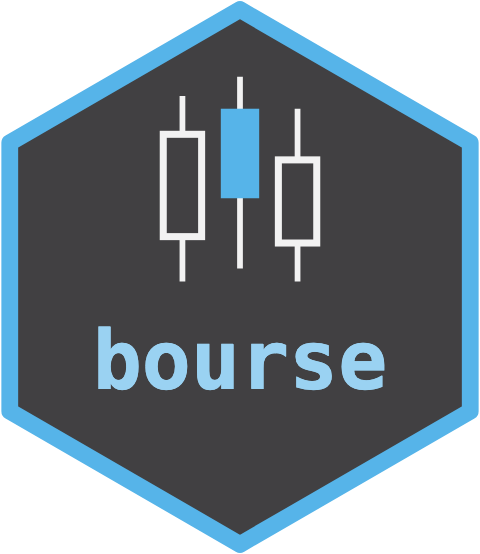

---
output:
  github_document:
    md_extensions: "-smart"
---

```{r, include = FALSE}
knitr::opts_chunk$set(collapse = TRUE, comment = "#>", fig.path = "man/figures/")
```

# bourse 

<!-- badges: start -->
[](https://github.com/max578/bourse/actions/workflows/R-CMD-check.yaml)
[](https://app.codecov.io/gh/max578/bourse)
[](https://max578.r-universe.dev/bourse)
<!-- badges: end -->

`bourse` is the market-data connector of the ORCHESTRA analytics framework: it
fetches cryptocurrency market data (OHLCV candles, order books, 24-hour tickers)
from public exchange APIs and emits it as a contract-typed, provenance-labelled
result. It is the trading-domain counterpart of the `terroir` geo-data collector.

Every external fact -- a symbol, a price tick size, a fee, a column's unit -- is
recorded in a provenance registry and treated as **unverified** until it has been
diffed against the exchange's own catalogue (the Independent Oracle Principle).
An ungrounded fact triggers a refusal rather than a silently wrong number. For a
trading system that is risk control, not bookkeeping: an unverified tick size or
fee is a number that loses money.

`bourse` supplies market data only. It gives no financial or trading advice.

## Related packages

- [cryptoQuotes](https://CRAN.R-project.org/package=cryptoQuotes) returns
  OHLC market data from major cryptocurrency exchanges as `xts` series, with
  sentiment indicators and interactive charts.
- [crypto2](https://CRAN.R-project.org/package=crypto2) downloads
  cryptocurrency information and daily historical prices from CoinMarketCap
  and CoinGecko.
- [binancer](https://CRAN.R-project.org/package=binancer) is a client for the
  Binance public REST API, for data collection, portfolio management and
  trading.

bourse reads Binance's public endpoints too, but each result carries the
grounding status of the facts it rests on (symbol, tick size, fee, units),
checked against the exchange's own catalogue, and it returns a refusal
instead of a value when a fact has not been checked.

## Installation

```{r eval=FALSE}
pak::pak("max578/bourse")
```

## Usage

Each verb returns either a grounded result object or a `bourse_refusal`. Here we
parse recorded fixtures offline (the live path uses the suggested `httr2`).

```{r}
library(bourse)

candles <- cbind(
  open_time = c(1.5e12, 1.5e12 + 86400000),
  open = c(100, 102), high = c(105, 106), low = c(99, 101),
  close = c(102, 104), volume = c(1200, 1500))

bourse_ohlcv("BTCUSDT", interval = "1d", candles = candles)

bourse_orderbook("BTCUSDT", depth = list(
  bids = list(c("100.0", "1.5")), asks = list(c("100.1", "1.0"))))

bourse_ticker("BTCUSDT", ticker = list(
  symbol = "BTCUSDT", lastPrice = "100.0", openPrice = "98.0",
  highPrice = "101.0", lowPrice = "97.0", volume = "1200",
  quoteVolume = "118800", openTime = 1.5e12, closeTime = 1.5e12 + 86400000))
```

A result is `[unverified]` until the catalogue-diff oracle has grounded the facts
it rests on; a consumer on a live order path gates on the grounding label.

## Grounding: the catalogue-diff oracle

`bourse_catalogue_diff()` is the only operation that grounds a fact. It diffs the
asserted facts against the exchange's own `/exchangeInfo` catalogue and grounds
those that agree with a real date. By default it grounds the multi-symbol core
universe (`BTCUSDT`, `ETHUSDT`, `BNBUSDT`, `SOLUSDT`).

```{r}
bourse_fact_status("binance")
```

## Known gap: the fee schedule

`bourse` reads public, anonymous endpoints only. The maker/taker
**`fee_schedule`** is sourced from the authenticated `/sapi/v1/asset/tradeFee`
endpoint, which would introduce an API-credential surface; it is deliberately not
implemented. That fact stays `[unverified]` in the registry rather than
substituting a documentation default the package cannot diff against the
account's actual fee tier. See `SECURITY.md`.

## Contributing

Bug reports and suggestions are welcome through the
[issue tracker](https://github.com/max578/bourse/issues). See
`CONTRIBUTING.md` for how to propose a change.

## Citation

```r
citation("bourse")
```

## License

This package is released under: MIT + file LICENSE.
